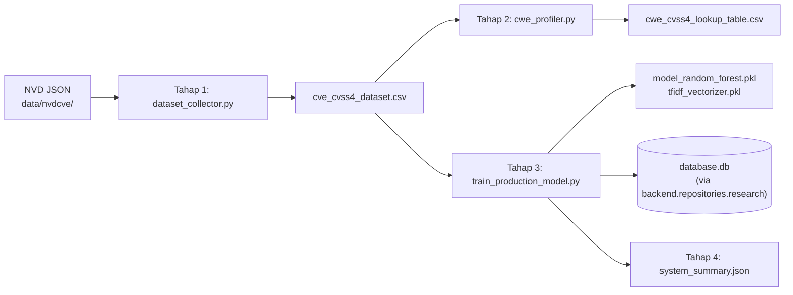

# Dokumentasi Arsitektur Sistem (`ARCHITECTURE.md`)

Dokumen ini menguraikan arsitektur **Sistem Pendukung Keputusan Penilaian Kerentanan HAST** versi 2: struktur modul, tanggung jawab berkas, aliran data, dan model data. Perubahan dari versi 1 (tag `v1.0.0-tesis`) dirinci pada [CATATAN_PERUBAHAN_DSS.md](CATATAN_PERUBAHAN_DSS.md).

---

## Prinsip Arsitektur

1. **Backend sebagai pemilik tunggal data.** Hanya backend yang membuka basis data. Antarmuka Streamlit menjadi klien tipis yang berkomunikasi melalui REST API.
2. **Logika keputusan murni dan teruji.** Modul `backend/dss/` tidak melakukan I/O dan tidak memanggil model ML sehingga dapat diuji tanpa artefak `.pkl`.
3. **Jalur skoring v1 tidak diubah.** `backend/engine.py` dan `backend/model_loader.py` dipertahankan. Uji regresi emas menjamin skor v2 identik dengan v1.
4. **Keputusan tetap pada manusia.** Sistem merekomendasikan, analis menetapkan, dan setiap perubahan tercatat dalam jejak audit.
5. **Reproduksibilitas.** Setiap ranking menyimpan metode, bobot, sumber bobot, hash konfigurasi, *escalation rate*, dan versi model.

Kerangka DSS mengikuti pembagian subsistem klasik (manajemen data, manajemen model, basis pengetahuan, dialog):

| Subsistem DSS | Implementasi |
| :--- | :--- |
| Manajemen data | SQLite (SQLAlchemy + Alembic), `cwe_cvss4_lookup_table.csv`, berkas konfigurasi JSON |
| Manajemen model | Random Forest + TF-IDF + SHAP (`backend/engine.py`); SAW/TOPSIS/WP, AHP, sensitivitas (`backend/dss/`) |
| Basis pengetahuan | Aturan rekomendasi (`dss_config.json`), teks solusi OWASP ZAP, pemetaan SonarQube → CWE |
| Dialog | Halaman Streamlit multipage (`frontend/`) |

---

## Struktur Direktori

```text
hast-vulnerability-model/
├── backend/
│   ├── api.py                      # Shim: `uvicorn backend.api:app`
│   ├── main.py                     # Factory FastAPI + lifespan (migrasi DB, pemuatan model)
│   ├── config.py                   # Fungsi konfigurasi v1 (ER, model aktif, kelas keparahan, metadata)
│   ├── engine.py                   # Mesin inferensi RF + SHAP (tidak diubah dari v1)
│   ├── model_loader.py             # Pemuat singleton artefak .pkl
│   ├── core/
│   │   ├── settings.py             # Settings terpusat (pydantic-settings, prefiks HAST_)
│   │   └── security.py             # Hash Argon2, token JWT
│   ├── db/
│   │   ├── models.py               # Model ORM (tabel v1 + tabel DSS)
│   │   ├── session.py              # Engine/sesi; pragma SQLite WAL
│   │   ├── bootstrap.py            # Migrasi + backfill data lama + seed + akun admin awal
│   │   └── migrations/             # Alembic (0001 baseline v1 idempoten, 0002 DSS)
│   ├── repositories/               # Akses data: history, research (SUS), users, dss
│   ├── services/
│   │   ├── parsers/                # Parser SonarQube/ZAP, pemetaan Sonar → CWE
│   │   ├── scoring.py              # Skoring batch, pemasangan hybrid, versi model
│   │   └── identity.py             # decision_key stabil lintas sesi
│   ├── dss/                        # Logika DSS murni
│   │   ├── criteria.py             # Matriks keputusan (C1–C8)
│   │   ├── mcdm.py                 # SAW, TOPSIS, WP, ranking deterministik
│   │   ├── ahp.py                  # Bobot AHP, CI/CR, agregasi pakar
│   │   ├── recommender.py          # Aturan rekomendasi, aksi, status, SLA
│   │   ├── sensitivity.py          # Sensitivitas bobot dan escalation rate
│   │   ├── evaluation.py           # Spearman, Kendall, Precision@k, persetujuan, Kendall's W
│   │   ├── escalation.py           # Rumus eskalasi engine sebagai fungsi murni
│   │   ├── config.py               # Muat/validasi/simpan dss_config.json
│   │   └── service.py              # Orkestrasi ranking, penjelasan, persistensi
│   ├── routers/
│   │   ├── deps.py                 # Dependency sesi DB dan pengguna
│   │   └── v1/                     # system, scoring, findings, research, auth, dss, decisions
│   └── config/                     # excluded_domains, system_summary, dss_config (+ .sample)
├── frontend/
│   ├── app.py                      # Navigasi multipage + panel login
│   ├── components/                 # Halaman dan komponen UI (lihat Bagian 2)
│   ├── utils/                      # api_client (satu-satunya jalur data), config, formatters
│   └── config/                     # app_config, sonar_rules_cache (+ .sample)
├── ai-model/                       # Pipeline data & pelatihan (tidak berubah, kecuali penulisan metrik via repositori)
├── database/                       # database.db (SQLite) dan backups/
├── deploy/                         # Unit systemd
├── tests/                          # pytest: unit, API, black-box, regresi emas, DSS
├── tools/                          # backup_db, dss_evaluation, regression, benchmark_latency, visualisasi, dll.
├── Dockerfile, docker-compose.yml  # Deployment kontainer
├── pyproject.toml, uv.lock         # Dependensi terkunci (requirements.txt diekspor dari lock)
└── alembic.ini
```

---

## 1. Backend (`backend/`)

### 1.1 Endpoint

| Kelompok | Endpoint | Akses |
| :--- | :--- | :--- |
| Sistem | `GET /`, `GET /api/v1/health`, `GET /system_summary.json`, `GET /sample-reports/{filename}` | Publik |
| Skoring (kontrak v1) | `POST /predict`, `POST /predict/hybrid`, `POST /predict/shap`, `POST /api/v1/scoring/shap/batch` | Publik |
| Ingest & batch | `POST /api/v1/ingest/sonarqube`, `POST /api/v1/ingest/zap`, `POST /api/v1/batches` | Publik |
| Riwayat | `GET /api/v1/history`, `GET /api/v1/batches`, `GET /api/v1/batches/{id}`, `POST /api/v1/history/shap` | Publik |
| Hapus riwayat | `DELETE /api/v1/batches/{id}`, `DELETE /api/v1/history` | Login |
| Korelasi | `POST /api/v1/correlation/preview`, `POST /api/v1/correlation/run` | Publik |
| Riset & SUS | `GET /api/v1/research/*`, `POST /api/v1/sus` (publik), `GET /api/v1/sus` (login) | Campuran |
| Autentikasi | `POST /api/v1/auth/login`, `GET /api/v1/auth/me`, `GET/POST /api/v1/users` (manajer) | — |
| DSS | `GET /api/v1/dss/config`, `PUT` (manajer), `POST /api/v1/dss/rank` (simpan: login), `POST /api/v1/dss/ahp` (simpan: manajer), `POST /api/v1/dss/sensitivity`, `POST /api/v1/dss/sensitivity/escalation-rate`, `GET /api/v1/dss/runs[/{id}]`, `POST /api/v1/dss/evaluate` (login) | Campuran |
| Dasbor | `GET /api/v1/dashboard?due_soon_days=7` (ringkasan hanya baca, dihitung oleh `backend/dss/dashboard.py`) | Publik |
| Keputusan | `GET /api/v1/decisions`, `PUT /api/v1/decisions/{key}` (login), `GET /{key}/events`, `GET /export.xlsx` (login), `GET /agreement` | Campuran |

### 1.2 Alur DSS

Satuan keputusan adalah **isu**: semua pasangan SAST–DAST dengan jenis alert OWASP ZAP dan CWE yang sama (`backend/dss/issues.py`). Prioritas P1–P4 ditentukan oleh aturan; MCDM hanya mengurutkan isu di dalam prioritas yang sama.

```mermaid
flowchart LR
    H["scan_history<br/>(pasangan, sesi HAST-*)"] --> I["issues.aggregate_issues<br/>isu = alert ZAP + CWE"]
    I --> C["criteria.build_matrix<br/>C1–C8 + penanda imputasi"
    L["cwe_cvss4_lookup_table.csv"] --> C
    D["dss_decisions<br/>(masukan analis)"] --> C
    K["dss_config.json<br/>bobot, metode, aturan, SLA"] --> C
    C --> M["mcdm.run_method<br/>urgensi di dalam prioritas"]
    C --> A["recommender.recommend<br/>P1–P4 dari aturan"]
    M --> R["Urutan: prioritas → urgensi → keparahan"]
    A --> R
    R --> E["Penjelasan bahasa biasa<br/>(faktor pembeda saja)"
    E --> P[("dss_runs + dss_decisions<br/>+ dss_decision_events")]
```

Kriteria yang dipakai (definisi dan asumsi *encoding* ada di `backend/dss/criteria.py`):

| Kode | Kriteria | Sumber data | Arah |
| :--- | :--- | :--- | :--- |
| C1 | Skor keparahan hybrid | `scan_history.predicted_score` | Benefit |
| C2 | Terverifikasi True Positive | `scan_history.is_true_positive` | Benefit |
| C3 | Eksploitabilitas CWE (AV, AC, AT, PR, UI) | Tabel lookup CWE | Benefit |
| C4 | Dampak CWE (VC, VI, VA) | Tabel lookup CWE | Benefit |
| C5 | Cakupan (jumlah lokasi terdampak) | Berkas + endpoint per isu | Benefit |
| C6 | Dampak bisnis (Tinggi 5 / Sedang 3 / Rendah 1) | Masukan analis (default Sedang) | Benefit |
| C8 | Upaya perbaikan (Kecil 1 / Sedang 2 / Besar 3) | Masukan analis (default Sedang) | Cost |

---

## 2. Frontend (`frontend/`)

`frontend/app.py` membangun navigasi multipage (`st.navigation`) yang dikelompokkan per alur kerja. Panel login berada di sidebar, dan token JWT disimpan di `st.session_state`.

| Kelompok | Halaman | Berkas |
| :--- | :--- | :--- |
| Keputusan | Dasbor (halaman pembuka) · Prioritas Perbaikan · Riwayat Keputusan | `page_dashboard.py`, `page_priority.py`, `page_decision_log.py` |
| Data Pemindaian | 1. SonarQube (SAST) · 2. OWASP ZAP (DAST) · 3. Korelasi Hybrid (masing-masing memuat bagian Penjelasan Skor (SHAP)) | `tab_sast.py`, `tab_dast.py`, `tab_hybrid.py`, `tab_shap_visual.py` (+ `analysis_flow.py`, `history.py`, `dialogs.py`) |
| Administrasi (manajer) | Pengguna | `page_users.py` |
| Riset & QA (mode dev) | Pengaturan Prioritas · Analisis Riset · Sensitivitas & Evaluasi DSS · Simulasi · Pengujian Black-Box | `page_dss_weights.py`, `tab_analysis.py`, `page_dss_research.py`, `tab_simulation.py`, `tab_blackbox_testing.py` |
| Rute khusus | Kuesioner SUS (`?page=sus`) | `page_sus_survey.py` |

`frontend/utils/api_client.py` adalah satu-satunya jalur data UI. Setiap panggilan memakai *timeout* dan menghasilkan pesan galat yang aman.

**Pengecualian:** halaman Simulasi dan Pengujian Black-Box (mode dev) menjalankan fungsi backend/model di dalam proses sebagai harness riset/QA. Kedua halaman itu tidak mengakses basis data riset; skenario DB pada Black-Box memakai DB sementara.

---

### Penjelasan skor di DSS (SHAP)

`backend/dss/explain.py` membentuk penjelasan per isu dari pasangan representatif. Penjelasan itu memuat:
- rantai skor hybrid;
- ringkasan SHAP atas prediksi model untuk teks gabungan (bukan dekomposisi skor hybrid);
- penanda heuristik **Perlu diperiksa** (`dss_config.review`).

SHAP tidak dipakai sebagai kriteria MCDM. Saat keputusan dicatat, backend menyimpan snapshot konteks model dari run terakhir ke `dss_decision_events.payload_json["konteks_model"]`.

### Peran dan hak akses

Peran dan hak didefinisikan di `backend/core/roles.py`, ditegakkan di backend lewat `require_permission(...)` dan pemeriksaan per kolom pada `PUT /api/v1/decisions/{key}`, lalu diteruskan ke UI saat login untuk menampilkan atau mengunci kontrol.

| Peran | Untuk | Hak utama |
| :--- | :--- | :--- |
| Administrator (`admin`) | Pengelola sistem | Seluruh hak, termasuk mengelola pengguna dan peran |
| Manajer Keamanan (`manager`) | Pengambil keputusan | Aturan prioritas, SLA, bobot/AHP; menerima risiko; mengubah prioritas; menghapus riwayat; ekspor |
| Analis Keamanan (`analyst`) | Penilai temuan | Tindak lanjut (PIC, tenggat, dampak bisnis, upaya); mengubah prioritas; positif palsu/ditunda; ekspor; evaluasi |
| Pengembang (`developer`) | Tim perbaikan | Memperbarui progres (Belum/Sedang dikerjakan/Selesai) dan catatan |
| Auditor (`auditor`) | Pimpinan/auditor | Baca saja, termasuk jejak audit, ekspor, dan rekap SUS |

## 3. Model Data (`database/database.db`)

| Tabel | Isi | Versi |
| :--- | :--- | :--- |
| `scan_history` | Temuan terskor (SAST, DAST, pasangan hybrid), dekomposisi SHAP, serta kolom terstruktur v2: `mitigation_text`, `sast_score`, `dast_score`, `is_true_positive`, `sast/dast_key_id`, `sast/dast_component`, `decision_key`, `model_version` | v1 + v2 |
| `dataset_metadata`, `dataset_class_distribution`, `model_evaluation_metrics` | Metadata dataset NVD dan metrik model | v1 |
| `sus_responses` | Respons SUS + `ui_version` | v1 + v2 |
| `users` | Akun (Argon2), peran `analyst` / `manager` | v2 |
| `dss_runs` | Parameter dan hasil lengkap setiap ranking yang disimpan | v2 |
| `dss_decisions` | Satu keputusan aktif per isu (`decision_key` = hash `CWE|alert`): rekomendasi sistem, prioritas yang ditetapkan analis, status, penanggung jawab (`owner`), tenggat, dampak bisnis, upaya | v2 (+`title`, `owner` di revisi 0003) |
| `dss_decision_events` | Jejak audit *append-only* | v2 |
| `alembic_version` | Revisi skema | v2 |

`decision_key` = SHA-256 dari `CWE|komponen SAST|komponen DAST`. Pair ID (`PAIR-XXXXXXXX`) dibuat ulang setiap kali korelasi dijalankan sehingga keputusan dikaitkan dengan identitas alami temuan.

---

## 4. Pipeline Model AI (`ai-model/`)

Pipeline empat tahap tidak berubah dari v1:



Tabel lookup hasil Tahap 2 kini juga menjadi sumber kriteria C3/C4 DSS.

---

## 5. Deployment

| Opsi | Berkas | Keterangan |
| :--- | :--- | :--- |
| Docker Compose (utama) | `Dockerfile`, `docker-compose.yml` | `api` + `ui` di jaringan Docker bersama Nginx Proxy Manager (alias `hast-api:8000`, `hast-ui:8501`), tanpa port terbuka ke host; data di-*mount* dari host |
| systemd | `deploy/systemd/hast-api.service`, `hast-ui.service` | Tanpa Docker; tanpa `--reload` |
| tmux | `app.sh.sample` | Lokal/server sederhana; `HAST_DEV=1` mengaktifkan `--reload` |
| CI | `.gitea/workflows/ci.yaml` | `uv lock --check` + `pytest` setiap *push* |
| Deploy manual | `.gitea/workflows/deploy.yaml` | `workflow_dispatch` via SSH: cadangan DB → `docker compose up -d --build` |
| Cadangan | `tools/backup_db/app.py` | SQLite online backup + pemeriksaan integritas + retensi |

---

## 6. Pengujian

| Berkas | Cakupan |
| :--- | :--- |
| `test_regression_golden.py` | Skor v2 identik dengan baseline `v1.0.0-tesis` (94 SAST, 20 DAST, 35 pasangan) |
| `test_dss_core.py` | MCDM (nilai hitung tangan), AHP, aturan, eskalasi, kriteria, sensitivitas, evaluasi |
| `test_dss_api.py` | Ranking, keputusan tidak tertimpa, jejak audit, AHP, izin peran, ekspor, SUS |
| `test_database.py` | Repositori riset/riwayat, adopsi DB v1 tanpa perubahan data |
| `test_backend_api.py`, `test_blackbox_scenarios.py`, `test_ai_model.py`, `test_history_shap.py`, `test_sonar_cwe_mapper.py`, `test_tab_shap_visual.py`, `test_formatters_and_hast.py` | Rangkaian v1 (nama dan asersi dipertahankan) |
| `test_ops_tools.py` | Alat cadangan basis data |
